<h1 align="center">witcher-hud</h1>

<p align="center">
<b>A Witcher 3 style HUD for Claude Code.</b><br>
Every prompt is a quest, every tool a sign, every token experience.
</p>

<p align="center">


</p>

<p align="center">
<picture>
<source media="(prefers-color-scheme: dark)" srcset="media/hero-dark.png">
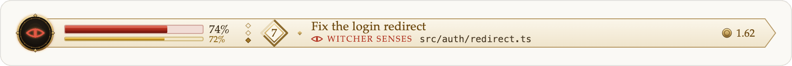
</picture>
</p>

<p align="center">
<a href="#install">Install</a> ·
<a href="#whats-new-in-40">What's new</a> ·
<a href="#what-it-shows">What it shows</a> ·
<a href="#moments-and-effects">Moments</a> ·
<a href="#sound">Sound</a> ·
<a href="#career">Career</a> ·
<a href="#commands">Commands</a>
</p>

The HUD sits in one slim row above the prompt and plays the session as a hunt. In the desktop app it is drawn on one plate that follows the app's light or dark look. In a terminal it is a single row of coloured cells, animated on the terminal's own clock; colours aside, it reads like this:

```
 ▲ ▂▂▂▂▂▂▂▂▂▂▂▂▂▂▂▂▂▂▂▂ 66%  ◆◆◇  Lv 5 ━━────  ⛁ 1.87  Fix the login redirect ◆ Igni: npm test
```

It speaks English or Russian. Current version: 4.1.0.

## Install

In a Claude Code session:

```
/plugin install witcher-hud --marketplace AlbatrosPromotions/witcher-hud
```

Answer `y` to add the marketplace, then pick a scope.

Or from a shell, with the language chosen up front (`en` is the default):

```
claude plugin install witcher-hud --marketplace AlbatrosPromotions/witcher-hud --config language=ru
```

To update an installed copy, then restart Claude Code:

```
claude plugin marketplace update witcher-hud
claude plugin update witcher-hud@witcher-hud
```

To remove it: `claude plugin uninstall witcher-hud@witcher-hud`.

## What's new in 4.0

The hunt comes alive, and it lasts.

- **Moments.** The plate plays out what happens: a quest completed or failed, a level up, a monster met when a tool fails and slain when it then succeeds, a trophy won, meditation while `/compact` runs. [See them all](#moments-and-effects).
- **A burst for every sign.** Igni's embers, Aard's shockwave, Quen's shield, Yrden's glyph circle, Axii's rings, the red sweep of Witcher Senses.
- **Sound.** Short original sounds for the signs and the moments. Out of the box only one plays: when Claude finishes. [Pick what you hear](#sound).
- **A career.** The level, the bestiary and the trophies carry over from one session to the next, with ten titles from Kaer Morhen Trainee to Grandmaster of the Wolf. [More](#career).
- **The journal.** `/hud journal` opens a pane with this session's quests, the bestiary, the trophies and the signs cast.
- **A livelier plate.** A flash when vitality drops, a red heartbeat when it runs low, and the time of day: dawn, day, dusk and a starry night.

## What it shows

<p align="center">
<picture>
<source media="(prefers-color-scheme: dark)" srcset="media/anatomy-dark.png">
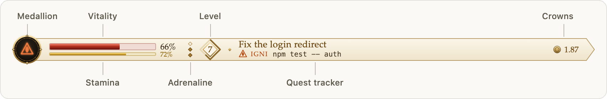
</picture>
</p>

| HUD | Meaning |
| --- | --- |
| **Medallion** | The wolf rests on it between quests. While Claude works it glows and shows the sign being cast, and shakes once as each sign is cast. |
| **Signs** | Bash is Igni, edits are Yrden, reading and searching files is Witcher Senses, the web is Axii, a subagent is Aard, anything else (MCP tools included) Quen. |
| **Vitality** (red) | Context window left. What a turn costs shows pale, then drains away. At 20% or less the bar pulses. |
| **Stamina** (yellow) | What is left of the 5-hour rate limit, when the API reports one, with its figure; red at 15% or less. In a terminal it is the yellow line along the vitality cells. |
| **Adrenaline** (a column of pips on the desktop, filling from the bottom) | A point for every 4 tool calls in a row that succeed, up to three. A failed tool costs all of it, a call you refuse costs nothing, and a point fades between quests. |
| **Level** | Experience is input, cache-write and output tokens, subagents' included; cache reads earn none. It adds up over your whole career, every session together: level 2 takes 250,000 XP and level L takes 250,000 × (L − 1)², so level 10 is at 20.25M and level 64 at a billion. On the desktop the ring around the level badge fills with the way to the next; in a terminal a thin gold bar does. |
| **Crowns** | The session's cost, as `/cost` totals it. |
| **Quest tracker** | The prompt's first line as the quest's name, and the sign at work as the objective, in the sign's colour, with what it acts on in monospace: the command, the file, the pattern, the site. When the turn ends: quest completed with the XP it earned, abandoned if you interrupted it, or failed. |
| **Character sheet** | On the desktop, the pointer on the medallion, bars or level shows the level's title, the experience to the next level, the tokens sent and generated, cache reads and model requests in the quest tracker's place. Each bar, the pips and the badge also show their numbers in a tooltip. |

On a narrow window the HUD makes room: on the desktop the crowns go first, then the quest name is cut, then the quest tracker steps aside; in a terminal the crowns go first, then the level, then the quest tracker. With the system's reduce-motion setting on, the desktop HUD keeps still.

The spinner speaks the trade too (Meditating, Casting Igni, Using Witcher Senses, Writing in the journal); on the desktop it only replaces a bare "Working". In a terminal the line that closes a turn reads like "Played Gwent for 42s".

Toasts announce each level up and each trophy, warn when vitality falls to 20% (meditate with `/compact` to recover), and say when meditation restored it.

Titles, from the level they start at: Kaer Morhen Trainee (1), Survivor of the Grasses (3), Novice Witcher (5), Monster Slayer (8), Contract Hunter (12), Silver Sword (16), Wolf School Master (20), White Wolf (25), Witcher of Legend (32), Grandmaster of the Wolf (40).

## Moments and effects

On the desktop the plate plays out what happens, each moment on its own clock, one after another. Every picture here is drawn by the HUD's own code.

### Signs

Each tool call casts a sign, and each sign bursts from the medallion its own way.

<table>
<tr>
<td align="center"><picture><source media="(prefers-color-scheme: dark)" srcset="media/sign-igni-dark.png">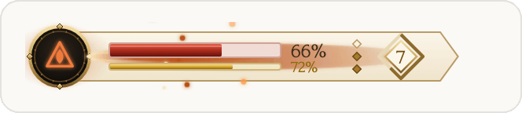</picture><br><b>Igni</b> · Bash</td>
<td align="center"><picture><source media="(prefers-color-scheme: dark)" srcset="media/sign-yrden-dark.png">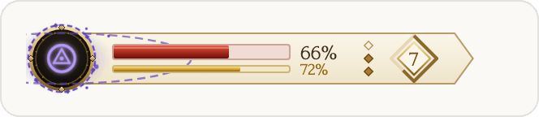</picture><br><b>Yrden</b> · file edits</td>
</tr>
<tr>
<td align="center"><picture><source media="(prefers-color-scheme: dark)" srcset="media/sign-senses-dark.png">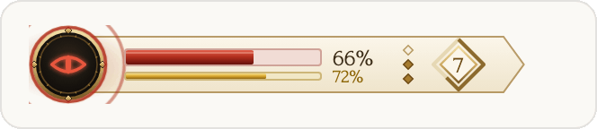</picture><br><b>Witcher Senses</b> · reading and searching files</td>
<td align="center"><picture><source media="(prefers-color-scheme: dark)" srcset="media/sign-axii-dark.png">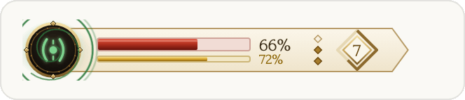</picture><br><b>Axii</b> · the web</td>
</tr>
<tr>
<td align="center"><picture><source media="(prefers-color-scheme: dark)" srcset="media/sign-aard-dark.png">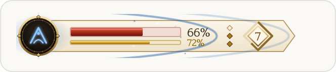</picture><br><b>Aard</b> · a subagent</td>
<td align="center"><picture><source media="(prefers-color-scheme: dark)" srcset="media/sign-quen-dark.png">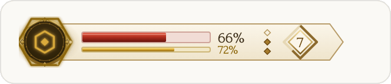</picture><br><b>Quen</b> · anything else, MCP tools included</td>
</tr>
</table>

### Quests and levels

**Quest completed.** Claude finished the prompt: the quest's name and the XP it earned, in gold.

<picture><source media="(prefers-color-scheme: dark)" srcset="media/quest-done-dark.png">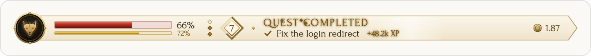</picture>

**Quest failed.** The turn stopped on an error: the quest in red. A turn you interrupt is abandoned, without a banner.

<picture><source media="(prefers-color-scheme: dark)" srcset="media/quest-failed-dark.png">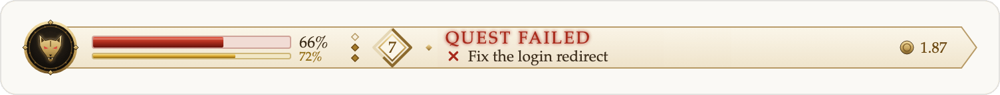</picture>

**Level up.** The level badge bursts into rays and the plate shows the new level and its title.

<picture><source media="(prefers-color-scheme: dark)" srcset="media/level-up-dark.png">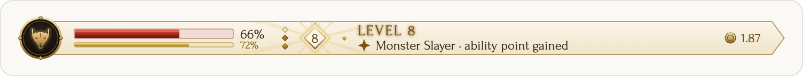</picture>

### Monsters and trophies

**A monster appears.** A tool that fails is a monster met, and claws rake the plate under its name and what failed. A failing test is a Drowner, a broken build a Griffin, a linter a Harpy, git a Wraith, an install a Ghoul, any other command a Wolf; a failed edit is a Kikimora, a read a Foglet, the web a Siren, a subagent a Leshy, anything else a Wyvern.

<picture><source media="(prefers-color-scheme: dark)" srcset="media/monster-dark.png">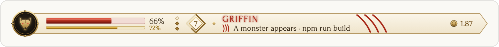</picture>

**Contract completed.** When that kind of call then succeeds, the monster is slain: a sword's slash, and a new entry in the bestiary.

<picture><source media="(prefers-color-scheme: dark)" srcset="media/slain-dark.png">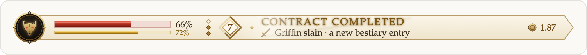</picture>

**Trophy.** A trophy won shines across the plate with its name and what earned it.

<picture><source media="(prefers-color-scheme: dark)" srcset="media/trophy-dark.png">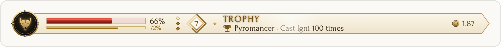</picture>

### Vitality and meditation

**Meditation.** While `/compact` runs the plate turns night blue, with stars and a campfire.

<picture><source media="(prefers-color-scheme: dark)" srcset="media/meditation-dark.png">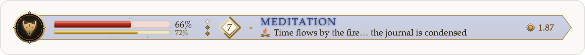</picture>

**Meditation complete.** When it gives vitality back, the bar refills and says how far.

<picture><source media="(prefers-color-scheme: dark)" srcset="media/restored-dark.png">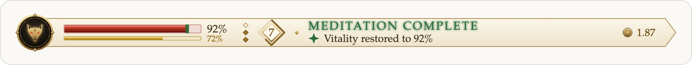</picture>

**Hit.** Vitality lost by 3 points or more at once flashes the bar, and the damage rises from it.

<picture><source media="(prefers-color-scheme: dark)" srcset="media/hit-dark.png">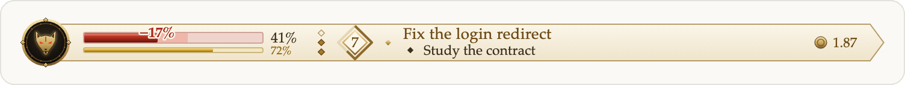</picture>

**Low vitality.** At 20% or less a red heartbeat pulses through the plate and the medallion trembles.

<picture><source media="(prefers-color-scheme: dark)" srcset="media/danger-dark.png">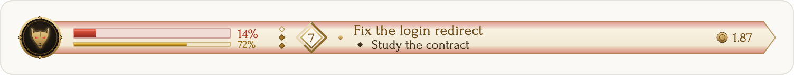</picture>

**Time of day.** Dawn, day, dusk and night tint the plate after your clock; at night stars come out. A full column of adrenaline burns brighter.

<picture><source media="(prefers-color-scheme: dark)" srcset="media/night-dark.png">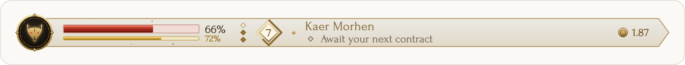</picture>

At most two moments are drawn at a time; the rest wait their turn, and a minor one that would wait more than 8 seconds is let go. In a terminal, level ups, trophies and vitality warnings come as toasts.

## Sound

> **Out of the box you hear one thing only: a short fanfare when Claude finishes**, and a different sound when the quest failed. Every other sound is off until you turn it on.

### What can sound

There are seven kinds of sound. Each one is on or off by itself.

| Kind | Plays when | Its name in commands | Out of the box |
| --- | --- | --- | --- |
| **Quests** | Claude finishes a prompt: quest completed, or quest failed | `quests` | **on** |
| **Signs** | each tool call, as its sign is cast | `signs` | off |
| **Level up** | you reach a new level | `levels` | off |
| **Monsters** | a tool fails (a monster appears), and when it then succeeds (contract completed) | `monsters` | off |
| **Trophies** | you win a trophy | `trophies` | off |
| **Meditation** | `/compact` starts, and when it gives vitality back | `meditation` | off |
| **Danger** | vitality, the context left, falls to 20% | `danger` | off |

Each sign has its own sound, and with Signs on you can still silence one sign alone:

| Sign | Cast by | Its name in commands |
| --- | --- | --- |
| Igni | Bash | `igni` |
| Yrden | file edits | `yrden` |
| Witcher Senses | reading and searching files (it sounds at every file read) | `senses` |
| Axii | the web | `axii` |
| Aard | a subagent | `aard` |
| Quen | anything else, MCP tools included | `quen` |

On top of the kinds there is the **volume**: **Full** (the default), **Quiet** or **Off**. It is the main switch: at Off nothing sounds, whatever kinds are on.

So a sound plays when the volume is not Off **and** its kind is on (for a sign, the sign too).

### Change it in the settings pane

Type `/hud sound` and a pane opens beside the chat. Out of the box it reads like this:

```
Volume   [Full]  Quiet  Off

✗ Signs · each tool, as its sign is cast
    Turn on   ▶ Listen
♪ Quests · a quest completed or failed
    Turn off  ▶ Listen
✗ Level up · a new level
    Turn on   ▶ Listen
✗ Monsters · a monster met, a contract completed
    Turn on   ▶ Listen
    …and Trophies, Meditation and Danger the same way
```

- **Volume**: press Full, Quiet or Off. The highlighted button is the volume now.
- **♪** marks a kind that is on, **✗** one that is off.
- **Turn on** / **Turn off** switches that kind.
- **▶ Listen** plays it once so you can hear it before you decide, even while it is off.
- When Signs is on, a row of buttons under it switches each sign alone.

Where no pane can open, `/hud sound` answers with the same settings as text, and a line on the commands:

```
✗ Signs · off
♪ Quests · on
✗ Level up · off
✗ Monsters · off
✗ Trophies · off
✗ Meditation · off
✗ Danger · off
```

### Or type a command

| To | Type |
| --- | --- |
| open the settings | `/hud sound` |
| set the volume | `/hud sound on` (Full), `/hud sound quiet` or `/hud sound off` |
| turn one kind or one sign on | `/hud sound <name> on`, for example `/hud sound levels on` |
| turn one kind or one sign off | `/hud sound <name> off`, for example `/hud sound senses off` |
| play a file of yours for a sound | `/hud sound file <sound> <path>`, see [A sound of your own](#a-sound-of-your-own) |

The names are the ones in the two tables above.

### Examples

| You want | Type |
| --- | --- |
| only to hear when Claude is done | nothing: that is how it starts |
| no sound at all | `/hud sound off` |
| softer sounds | `/hud sound quiet` |
| no fanfare when Claude is done | `/hud sound quests off` |
| your own clip when Claude is done | `/hud sound file quest-done ~/Music/done.mp3` |
| level ups and trophies too | `/hud sound levels on`, then `/hud sound trophies on` |
| every sign but the one at each file read | `/hud sound signs on`, then `/hud sound senses off` |
| everything | `/hud sound` and press **Turn on** on each kind |

### Good to know

- **Settings are kept on this computer** and apply in every session and every project. The kinds turned on or off are kept in Claude Code's store for plugins; the volume is the plugin's `sound` option, set the same ways as [`language`](#language).
- **A session already open elsewhere** picks up a kind turned on or off the next time it starts.
- **Sounds never pile up**: signs sound at most once in 0.8 s, the same sign once in 2.5 s, and they give way to a moment's sound.
- **They play only where the HUD is on screen**, never in a headless run (`claude -p`).
- **They are original**: short clips synthesized from oscillators and noise, kept in [`sounds/`](sounds) as WAV files. No sound from the games is used.

### A sound of your own

Any clip on your computer can take the place of one of the HUD's sounds:

```
/hud sound file quest-done ~/Music/done.mp3
```

From then on that file plays when Claude finishes, in every session, and it plays once right away so you hear it. It can be an MP3, WAV, M4A or AIFF file of up to 4 MB; a path with spaces works as it is or in quotes. The HUD keeps only the path: the file stays where it is and is read each time it plays, so if you move or delete it, the HUD's own clip plays instead.

| To | Type |
| --- | --- |
| see which sounds play a file of yours | `/hud sound file` |
| choose a file for a sound | `/hud sound file <sound> <path>` |
| go back to the HUD's clip | `/hud sound file <sound> reset` |

The sounds: `quest-done`, `quest-failed`, `level-up`, `monster`, `slain`, `trophy`, `meditate`, `restored`, `danger`, and the signs `igni`, `aard`, `quen`, `yrden`, `axii`, `senses`. The kinds turned on or off still apply: a file for `level-up` sounds only while Level up is on.

**Or put it in the plugin's folder.** A file in `sounds/local/` inside the plugin's folder, named after the sound it replaces (`sounds/local/quest-done.mp3`), plays too; it is picked up when a session starts. git ignores `sounds/local/`, so those clips stay on your computer: an update never removes them, and they are never published with the plugin. A file chosen with the command comes first.

## Career

The level, the bestiary and the trophies last. The HUD keeps them on this computer in Claude Code's store for plugins and adds every session to them. Each session keeps its own record, and `/clear` starts a new one, so sessions running side by side never overwrite each other. Headless runs (`claude -p`) count for nothing.

- **Bestiary**: the eleven monsters above, each with how often you met and slew it, and its lore.
- **Trophies**: eighteen, from First Contract (complete a quest) through Pyromancer (Igni 100 times), Flawless (24 clean casts in a row), Night Hunter (a quest completed between midnight and five), Griffin Slayer (mend a broken build), Inner Peace (meditate 5 times) and Epic Quest (1M XP in one quest) to A Hundred Contracts. Each is announced once, ever.
- **Journal**: `/hud journal` opens a pane beside the chat: the career's level and its bar, this session's quests with how each ended and its XP, the bestiary, the trophies with the progress of those still locked, and the signs cast.

## Language

The HUD speaks English or Russian. The Russian follows the game's own Russian edition: Игни, Квен, Ведьмачье чутьё, «Задание выполнено», кроны. The closing line reads «Играл в гвинт 1 мин 4 с», numbers take a decimal comma, and the text is set in serifs that carry Cyrillic.

<picture><source media="(prefers-color-scheme: dark)" srcset="media/ru-done-dark.png">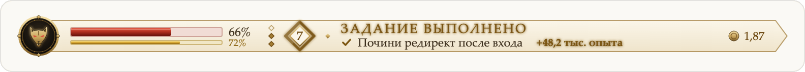</picture>

- `/hud lang ru` or `/hud lang en` switches it, and it stays switched in every session.
- It is also the plugin's `language` option: `--config language=ru` at install, `/plugin configure witcher-hud@witcher-hud`, or the plugin's Language row in `/config`. That row is not Claude Code's own Language setting, which picks the language Claude answers in.
- In `~/.claude/settings.json` it is kept under `pluginConfigs` → `"witcher-hud@witcher-hud"` → `options.language` (`"witcher-hud"` for a copy loaded with `--plugin-dir`).

## Theme

On the desktop the HUD follows the app's appearance: the dark plate in dark mode, a light parchment plate in light mode.

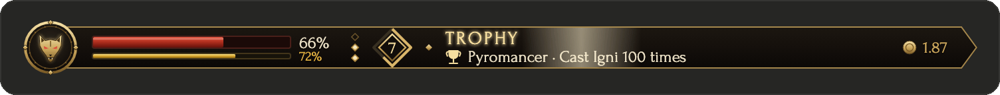<br>


- `/hud theme auto`, `/hud theme dark` or `/hud theme light` picks it, and it stays picked in every session.
- It is also the plugin's `theme` option, set the same ways as `language`.

## Commands

| Command | What it does |
| --- | --- |
| `/hud` | Sheathes or draws the HUD. |
| `/hud journal` | Opens the journal pane: quests, bestiary, trophies and signs. |
| `/hud stats` | Shows the character sheet: every number behind the bars, with the context used, the tokens sent, generated and read from cache, and the model requests made. |
| `/hud sound` | Opens the sound settings. `/hud sound on\|quiet\|off` sets the volume, `/hud sound <name> on\|off` one kind of sound or one sign, `/hud sound file <sound> <path>\|reset` a file of yours for a sound. See [Sound](#sound). |
| `/hud lang en\|ru` | Picks the language. |
| `/hud theme auto\|dark\|light` | Picks the desktop theme. |

Token counts start when the plugin loads; cost, context and stamina cover the whole session.

## Credits

The desktop HUD's lettering is the system's own Palatino (Palatino Linotype on Windows); no font ships with the plugin. The desktop app's page policy blocks web fonts inside the HUD's frame, so an embedded face would never load there.

The sign glyphs, medallion, effects, monsters' lore, sounds and wording are original work in the spirit of the games; the sounds are synthesized from oscillators and noise, no recordings. No art, sound or text from the games is used. The Witcher is a trademark of CD PROJEKT S.A.; this is an unofficial fan project.

## Develop

<details>
<summary>Files, checks and releases</summary>

```
claude --plugin-dir ./witcher-hud
claude plugin validate ./witcher-hud
claude plugin test ./witcher-hud
```

| File | What it holds |
| --- | --- |
| `hooks/register.tsx` | The hooks: counts tokens, runs quests and signs, queues the moments, plays the sounds, keeps the career, draws the HUD, the journal and the sound settings, answers `/hud`. |
| `hooks/career.ts` | The career: deeds added up across sessions, the monsters and the calls that breed them, the trophies and their rules, in both languages. |
| `hooks/fx.ts` | The desktop HUD's effects: each sign's burst, the hit, the moments' banners, meditation and the time of day, each on its own clock. |
| `hooks/lore.ts` | The words in both languages, signs, levels and number formats. No engine calls, so tests and previews run it anywhere. |
| `hooks/layout.ts` | The desktop HUD's geometry: one grid every box is placed on, centred on the midline with even gaps, laid out for each band of widths. |
| `hooks/art.ts` | The desktop HUD as one SVG drawn from that layout: the character, the quest tracker and the character sheet, both themes. It fills its frame's width, each band's parts shown by a CSS media query. |
| `hooks/font.ts` | Palatino's measurements (generated): each character's advance, regular and bold, and the face's heights, so text is measured as it is drawn. |
| `hooks/terminal-hud.ts` | The terminal row, animated on the terminal's own frame clock. |
| `sounds/` | The clips the HUD plays: 16-bit mono WAV. |
| `media/` | This README's pictures, drawn by `hooks/art.ts` at twice the size in both themes; the first is an animated PNG. |
| `types/index.d.ts` | The shapes of the HUD's session state and its career. |
| `tests/witcher-hud.test.ts` | The tests `claude plugin test` runs. |
| `tests/career.test.ts` | The career, moments, sounds and their settings, and the journal, against a stand-in for the engine and its store. |
| `tests/geometry.test.ts` | The layout's rules checked over 140 widths: symmetry, gaps, whole pixels, no overlaps, text that fits; and across every band of widths, no part that appears or drops inside one, and the right-hand parts' gap. |

Claude Code writes `.claude-plugin/types/` and `tsconfig.json` each time it loads the plugin; both are gitignored. Bump `version` in `.claude-plugin/plugin.json` with each release, since `claude plugin update` goes by it.

</details>

## Versions

- **4.1.0** A new sound when Claude finishes: a short fanfare, a lute running up to a major chord with brass, a drum and a bell, as loud as before and still original. `/hud sound file <sound> <path>` plays any MP3, WAV, M4A or AIFF file on your computer for one of the HUD's sounds, in every session; `/hud sound file` lists them and `/hud sound file <sound> reset` puts the HUD's clip back.
- **4.0.1** The desktop HUD's words no longer run together. The desktop app blocks web fonts inside the HUD, so the embedded face never loaded and a wider fallback was drawn over widths measured for it; the HUD now draws with the system's Palatino and measures with its own widths. A two-digit level sits in the middle of its badge. A sound of your own: a clip in `sounds/local/`, named after the sound it replaces, plays instead and stays on your computer.
- **4.0.0** The hunt comes alive and lasts. Moments play out on the desktop plate: a quest completed or failed, a level up, a monster met when a tool fails and slain when it then succeeds, a trophy, meditation while `/compact` runs and the vitality it gives back; with each sign's own burst, a hit flash, a low-vitality glow and the time of day. Sounds for the signs and the moments, only a quest's end on at first: `/hud sound` opens their settings, where each kind (or each sign) turns off on its own, and `/hud sound on|quiet|off` sets the volume. A career kept across sessions: the level counts all your experience on a new curve (250,000 XP to level 2, ten titles up to Grandmaster of the Wolf at level 40), a bestiary of eleven monsters, eighteen trophies, and `/hud journal`, a pane with the session's quests, the bestiary, the trophies and the signs. A subagent's prompt no longer renames the quest. The README shows it all in pictures.

<details>
<summary>Earlier versions</summary>

- **3.1.1** Fixes 3.1.0 on the desktop: the HUD's frame was given no width, and the app drew it at a browser's default 300px, so only the narrowest tier showed (the medallion, the bars and the level, without the quest or the crowns). The frame now asks for the full width and the band holds it to its own, so the HUD fills the band up to 960px. An update no longer blinks the HUD: the desktop draws an Svg in a frame that has to load, and a new drawing used to replace the old one and leave the band empty until it loaded. Now the new drawing is laid over the one on show, which stays untouched until the new one has had time to load, and only then takes its place. A redraw with nothing new keeps the frame as it is, and the medallion's breathing, the low-vitality pulse and the level-up glow carry on from where they were instead of starting over.
- **3.1.0** The desktop HUD is one drawing that fills the band at any width: the plate reaches the right edge, the crowns stay at its end, and the quest's text is cut to the room it has, all read from the drawing's own width instead of a guess from the band's columns. Updates no longer blank the quest's half for a moment, and the title's letter spacing is counted when it is cut.
- **3.0.0** The desktop HUD redrawn on one grid: one plate, the figures beside their bars, adrenaline as a column of pips, experience as a ring on the level badge, the sign's colour and a monospace target in the quest tracker, the crowns at the plate's end. A light parchment theme after the app's appearance and `/hud theme`, tooltips and a character sheet under the pointer, an embedded title face with Cyrillic, one shake per cast instead of a constant one, and stillness under reduce motion.
- **2.1.1** The README and the marketplace listing brought up to date; the HUD itself is unchanged.
- **2.1.0** Russian, after the game's Russian edition, and the `language` option with `/hud lang`.
- **2.0.0** The compact HUD: one row, a drawn medallion and sign glyphs, the quest tracker, adrenaline from clean tool streaks, the themed spinner and closing line, and `/hud stats`. Signs were remapped: reading is now Witcher Senses, the web Axii, a subagent Aard.
- **1.0.0** The first HUD: a framed panel of bars, with adrenaline from prompt cache hits.

</details>
